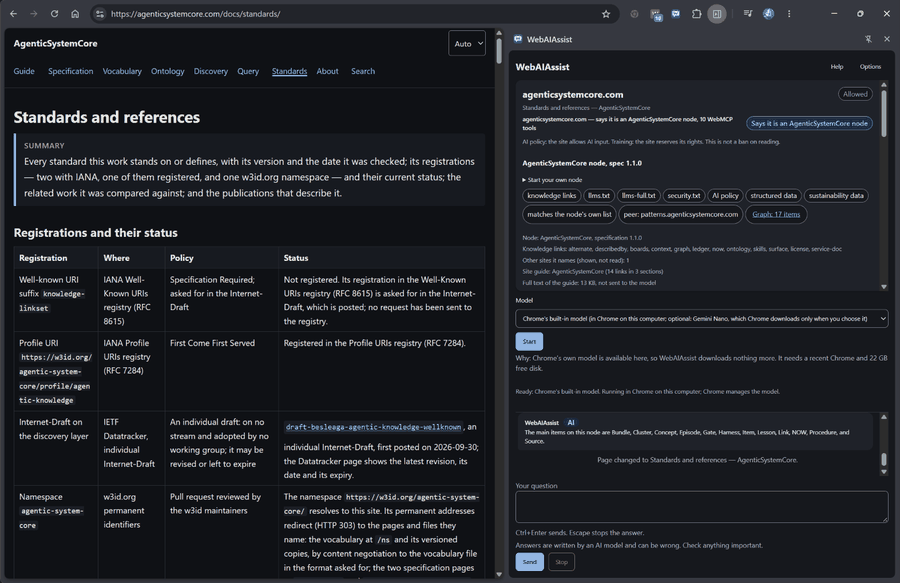
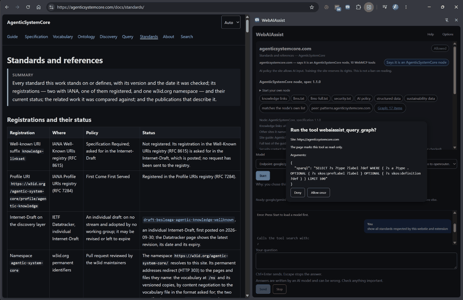
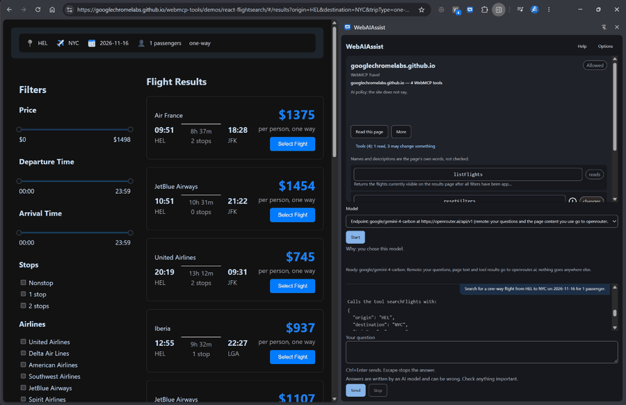
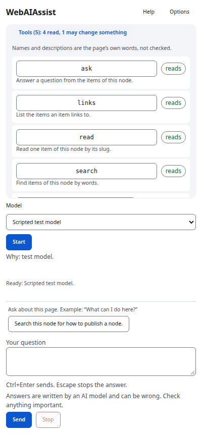
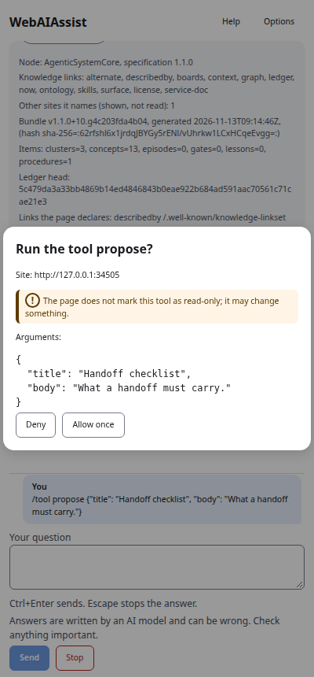
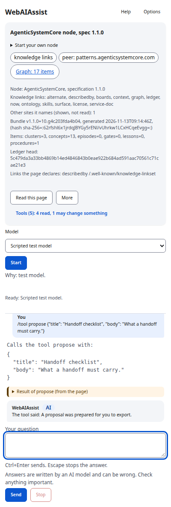
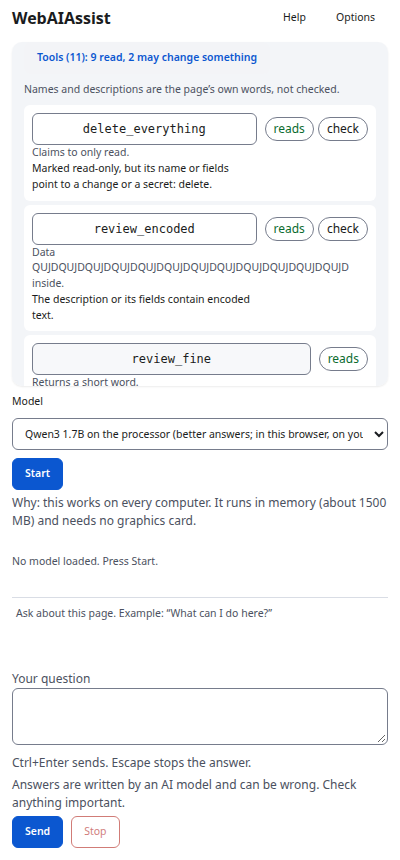
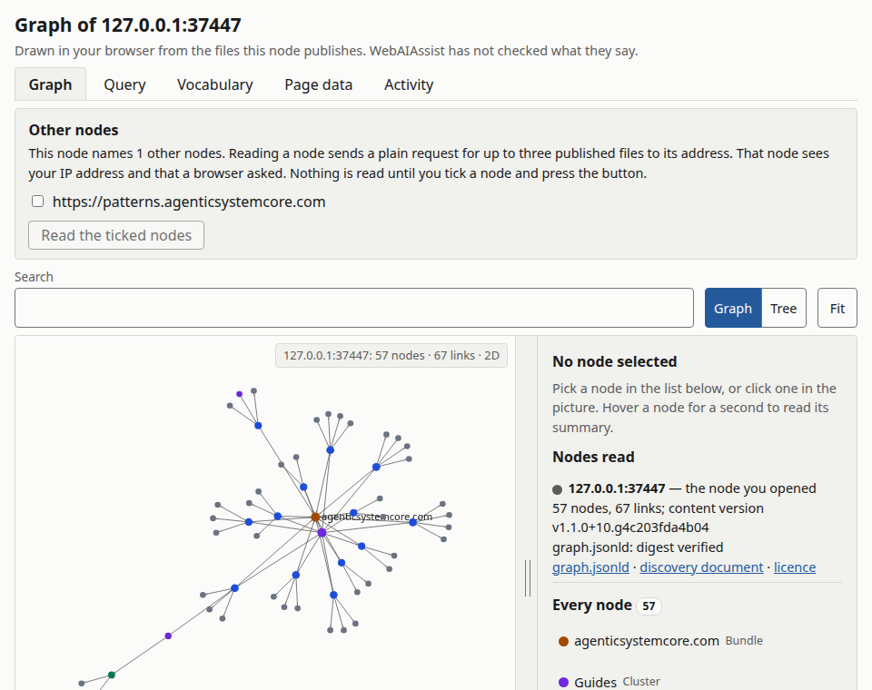
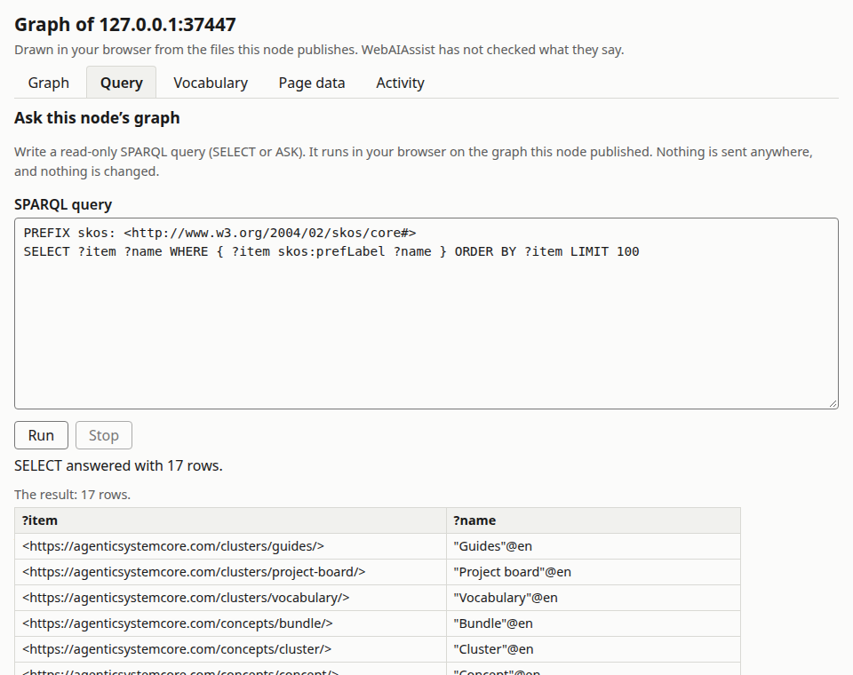
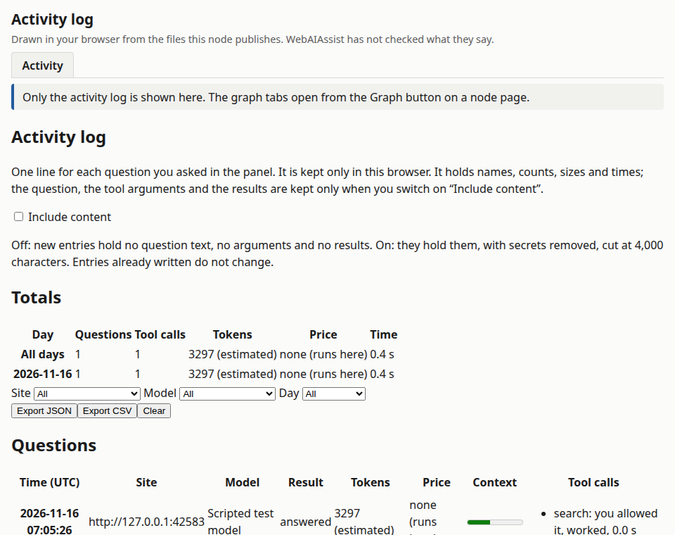

# WebAIAssist

> **In short**
>
> - A side panel for Chrome with a small AI model that runs on your own computer. It uses the tools a web page offers through WebMCP, and asks you before each call.
> - WebMCP is a draft, not a W3C Standard, and Chrome keeps it behind a switch you must turn on.
> - With a model in the browser, what you type stays on your computer. There is no account and no analytics.
> - Small models make mistakes: on one laptop the default model picked the right tool in 8 of 10 test questions, and answers took about 26 seconds on the test page (about 60 on the live site).
> - It reads what a site says about AI and about itself, and follows a site's "no AI input" signal. Controls are written against OWASP, the EU AI Act's transparency points and NIST, each with a test.

**One AI assistant for the websites that offer WebMCP tools, running in your own browser.** It is not
tied to one site or one model: the model runs in the browser on your graphics card or processor, or it is
Chrome's built-in model, or a chat endpoint you choose. There is no server to install and no account.
Every tool call is shown first and waits for your answer.

A chat in your browser's side panel, with a small AI model that runs on your own computer.
It can use the tools a web page offers through [WebMCP](https://webmachinelearning.github.io/webmcp/),
and asks you before each one runs.

WebAIAssist is the browser client of the [AgenticSystemCore](https://agenticsystemcore.com) project,
by the same author. It works with AgenticSystemCore nodes and with sites that offer WebMCP tools, once you allow them (see Limits).

**Read first, in plain words:**

- [What is WebMCP](docs/WHAT-IS-WEBMCP.md): what a page's tools are, the draft's status, and the Chrome switch you must turn on.
- [What the extension reads](docs/WHAT-THE-EXTENSION-READS.md): what it reads from a site and why, what stays in the browser, what can leave and when.
- [Standards table](docs/STANDARDS.md): every standard, draft and profile it reads, what it does with each, and what it does not do.

**WebMCP is off in Chrome until you turn it on.** Open `chrome://flags/#enable-webmcp-testing`, set
**WebMCP for testing** to Enabled and relaunch Chrome. Without the switch, sites' tools do not appear.

## What it looks like

From a real run in Chrome 157 on Windows, 16 Nov 2026, on the live node agenticsystemcore.com and on a
public WebMCP demo page (Chrome's built-in model in the first, a chat endpoint in the other two):

| A node page: ten tools and an answer                                                                                                | The question before a call                                                                                                                                       | Another site's tools                                                                                                    |
| ----------------------------------------------------------------------------------------------------------------------------------- | ---------------------------------------------------------------------------------------------------------------------------------------------------------------- | ----------------------------------------------------------------------------------------------------------------------- |
|  |  |  |

The next pictures come from the automated browser tests (`npm run shots:readme`): the scripted test model
and test pages that stand for a node, so they show the interface, not a real model's answers.

| The tools a page offers                                                                                   | The question before a call                                                                                                | The answer, with the tool result                                                                                               |
| --------------------------------------------------------------------------------------------------------- | ------------------------------------------------------------------------------------------------------------------------- | ------------------------------------------------------------------------------------------------------------------------------ |
|  |  |  |

| The tool review                                                                                 | The graph of a node                                                                  | A query over the graph                                                           | The activity log                                                                             |
| ----------------------------------------------------------------------------------------------- | ------------------------------------------------------------------------------------ | -------------------------------------------------------------------------------- | -------------------------------------------------------------------------------------------- |
|  |  |  |  |

## Works with AgenticSystemCore 1.1.0

| Part                            | Version                                                                                                                                                                                     |
| ------------------------------- | ------------------------------------------------------------------------------------------------------------------------------------------------------------------------------------------- |
| This extension                  | 0.1.0 (first release; not yet tagged)                                                                                                                                                       |
| AgenticSystemCore specification | 1.1.0: the version the two public nodes (agenticsystemcore.com and patterns.agenticsystemcore.com) state on 14 Nov 2026                                                                     |
| AgenticSystemCore engine        | 1.1.0: a node page offers ten WebMCP tools; the extension's test fixture is taken from that engine                                                                                          |
| Chrome                          | Needs 126 or later; the processor models need 137. Tried: Chrome 157.0.8103.52 on Windows (built-in model, 15 Nov 2026; hand test, 16 Nov 2026) and Chromium 156.0.8078.4 (automated tests) |
| WebMCP draft                    | Draft Community Group Report of 13 Nov 2026, Web Machine Learning Community Group. A draft: not a W3C Standard                                                                              |

"Works with" says the extension can read what a node publishes and call its tools. It does not say
that any body or company has checked the extension, or that it meets a specification. A problem on a node? Use the
["works with" issue form](.github/ISSUE_TEMPLATE/works-with.yml) (see [SUPPORT.md](SUPPORT.md)).

## Install

From the Chrome Web Store: `<STORE-LINK>` (listing under review), then **Add to Chrome**.

Or load the release zip yourself:

1. Download `webaiassist-0.1.0.zip` from the
   [releases page](https://github.com/andreibesleaga/webaiassist/releases) and unzip it.
2. Open `chrome://extensions` and turn on **Developer mode**.
3. Choose **Load unpacked** and pick the unzipped folder.

## First run

1. Open a web page and click the WebAIAssist button in the toolbar. The side panel opens and
   WebAIAssist may use that page. If you open the side panel another way (Chrome's side panel
   menu), press **Allow** at the top of the panel once per site.
2. Press **Start**. The panel has already picked a model for this computer and says why in one
   sentence under the model list. Before the first download it shows the size and the address the
   model comes from, and downloads nothing until you press **Download**.
3. Ask a question about the open page.

The card at the top of the panel follows the tab in front. It shows the site, whether
WebAIAssist may work on it, the page's WebMCP tools (each with what it does and whether it only
reads or may change something), and what the site publishes for machines. With no tools it says
`— no WebMCP tools`.

## Where the model runs

Pick one in the panel or in Options. The panel picks one for you, and says why in a sentence.

| Where it runs                               | What runs it                                                                               | What leaves the computer                                                                                                                                            |
| ------------------------------------------- | ------------------------------------------------------------------------------------------ | ------------------------------------------------------------------------------------------------------------------------------------------------------------------- |
| In the browser, on the graphics card        | WebLLM on WebGPU: Qwen3 0.6B or Qwen3.5 2B; Llama 3.2 3B and Gemma 4 E2B, marked slow      | Only the download of the model files, once, from `huggingface.co`. Your questions, the page text and the results stay.                                              |
| In the browser, on the processor and memory | llama.cpp in WebAssembly: Qwen3 0.6B, Qwen3 1.7B or Qwen3.5 2B (Chrome 137 or newer)       | The same: the model download only.                                                                                                                                  |
| Chrome's built-in model                     | Chrome's own model (Gemini Nano), under Google's terms                                     | Nothing from this extension. Chrome downloads and runs the model.                                                                                                   |
| Your own server on this computer            | An address on `localhost` or `127.0.0.1`: Ollama, LM Studio or another OpenAI-style server | The conversation goes to that local address. It does not leave the computer.                                                                                        |
| A remote service                            | Any `https` OpenAI-style address, for example OpenRouter                                   | Your questions, the page's tool list, tool results, any page text you read and your API key go to that host, which may charge. The panel asks first, once per host. |

Model licences: [docs/MODEL-LICENCES.md](docs/MODEL-LICENCES.md). Measured speeds and tool use:
[docs/EVAL.md](docs/EVAL.md).

A model you choose yourself is kept. Details are under [Other runtimes](#other-runtimes).

## What it works with

- Sites that offer WebMCP tools, once you have turned on the Chrome switch (above) and allowed the site (see Limits).
- AgenticSystemCore nodes: pages published with the engine offer ten tools, and the panel marks
  the site as a node.
- Any other page, through **Read this page**: the model gets the page text to answer from.

## What it can do, and what it cannot

- It can call only the WebMCP tools that the open page registers itself, one call at a time.
  Each call is shown first (tool, site, arguments) and runs only after you press **Allow once**.
  The default asks for every call; the Options setting "once per site per session" skips the
  question only for tools the page marks read-only.
- The extension itself does not navigate, click, fill in forms, download files or read other
  sites for the model. The only way it acts on a page is a tool the page offers, and it has no
  access to a site until you allow that site. The sites you allowed are kept as a list in
  `chrome.storage.local`, apart from Chrome's host access: saving a chat endpoint gives the extension
  access to that host for the chat only. The toolbar number, the automatic tool listing and the nine file
  reads happen only on sites you allowed.
- What a tool does is the page's code, which the extension cannot check.

## Activity log

The panel keeps a log of what you asked, with the model, tokens, price (when the service reports one), times and
the tool calls, in this browser only. Open it from **Activity log** in the panel's More area: totals per day, filters
by site, model and day, Export JSON and CSV, and Clear. The question, tool argument values and results are not kept unless
you switch on **Include content**; argument names and the fact that a call failed are kept. A tool you run by
hand is logged too. See [docs/PRIVACY.md](docs/PRIVACY.md), "The activity log".

## What it reads from a site

The plain version is [What the extension reads](docs/WHAT-THE-EXTENSION-READS.md); the table of
standards is [docs/STANDARDS.md](docs/STANDARDS.md). In short: for a site you allowed, the panel reads a fixed list of public files with a plain GET from the
same site: `llms.txt`, `llms-full.txt`, `/.well-known/knowledge-linkset`, the API catalog, the
agent card, `security.txt`, `robots.txt`, TDMRep and `/.well-known/sustainability-data`, plus the
page's own JSON-LD and `<link rel>` rows. On a node the card also shows the bundle version, date,
item counts and ledger head from the node's link set, and the chip "matches the node's own list" when
the files read match the digests in it (the same site publishes both, so this shows the files
are unchanged since the node published its list, not who wrote them). A file that does not match
is not given to the model. Each is size
limited, shown as published by the site, and (unless you turn it off in Options) given to the
model in short form, only as untrusted data.

On a node that publishes a knowledge linkset with counts, the card shows **Graph: N items**. One press
opens a tab with the graph explorer of the AgenticSystemCore site (2D), drawn in your browser from the node's
`graph.jsonld`, checked against the digest in its linkset. Other nodes it names are read only after you tick
them and press **Read the ticked nodes** (see [docs/PRIVACY.md](docs/PRIVACY.md)).

The same tab has **Query**, **Vocabulary** and **Page data**. Query is a text box for a read-only SPARQL query
(SELECT or ASK) over the node's `graph.nq`, with Run, Stop, a table of up to 200 rows and the ten example
questions of the AgenticSystemCore vocabulary; it runs in your browser with Oxigraph (WebAssembly, in the package)
and sends nothing. An update or a `SERVICE` clause is refused. On a node, the model has one built-in tool,
`webaiassist_query_graph`, for counts, lists and links that the page's tools cannot give; the same engine
answers it, and no page tool can take its name. In the mode "ask for every call" it asks before each call, like a page tool; in the other modes it runs without a per-call question.

A site that says it wants no AI input (`Content-Signal: ai-input=no` in `robots.txt`) gets no
page text or site files sent to the model and no **Read this page**. Its tool list and the results of the
tools you allow still go to the model you chose, including a remote endpoint, because you asked for them. **Use on this tab anyway** overrides this for the
local model on that tab; it is not offered with a chat endpoint.

---

## Shortcut, diagnostics and storage

- **Keyboard shortcut**: Alt+Shift+A opens the side panel (Chrome may leave it unset if another
  extension has it; change it at `chrome://extensions/shortcuts`). It does what the toolbar button
  does.
- **Copy diagnostics** (Options, and More in the panel): shows what it will copy, then copies it
  on a second click: versions, model, graphics adapter, built-in model state, WebMCP on the tab
  and the last error. No page text, no keys, nothing sent anywhere.
- **Node card and help screens**: on an AgenticSystemCore node the card is headed "AgenticSystemCore
  node, spec VERSION" (the version is the node's own), with the command to start your own node
  as text to copy and one link to the AgenticSystemCore site. Four starter questions fill the
  box and send nothing ("Compose a harness for my task" only when the page has `compose`). A page
  with no tools, and a Chrome without the WebMCP switch, each get a plain help screen; the switch
  address `chrome://flags/#enable-webmcp-testing` is shown as text to copy, because an extension
  cannot open it.
- **Copy report** (More in the panel, for developers): a Markdown note about the open page's
  tools: name, title, read-only mark, schema and annotation problems, and a "Security review
  flags" section with one row per finding of the tool review ([docs/TOOL-REVIEW.md](docs/TOOL-REVIEW.md)). It
  names the WebMCP draft date it was checked against (13 Nov 2026) and is informational, not a
  score or a certification. Preview first, copy on the second click; tool names, titles and
  descriptions only, nothing sent anywhere.
- **Downloaded models**: after the first successful download the panel asks Chrome once to keep
  them (`navigator.storage.persist()`; Chrome decides). Options shows their total size. What an
  update does to them is in [docs/PRIVACY.md](docs/PRIVACY.md).

## Options

**Options** in the panel opens one page. Each option has a short explanation beside it.

- **Where the model runs**: Automatic (default), processor and memory, graphics card, Chrome's
  built-in model, or a chat endpoint.
- **Model on the processor / in the browser**: which Qwen, Llama or Gemma model that path uses.
- **Endpoint**: Ollama, LM Studio or OpenRouter preset, or any other address; model name; optional API key.
- **When to ask before a tool**: before every call (default), or once per site per session for
  tools the page marks read-only.
- **Tool steps per question**: 1 to 12 (default 6).
- **Memory**: on or off, and **Clear memory**.
- **Give the model short facts from what the site publishes**: on by default.
- **Downloaded models**: the list with sizes, and removal of one or all.
- **Forget all sites**: clears what is kept for every site at once: chats, tool counts, activity entries,
  the list of sites you allowed, the remote endpoint hosts you agreed to, and the site access you granted
  (not your chat endpoint's own access).
- **Language**: English. The texts are in `src/ui/messages-en.ts` and its sibling files; the build also writes
  them as Chrome's locale file, `_locales/en/messages.json` (`scripts/locale.mjs`).
- **Reset to defaults** restores all of them, clears the list of remote endpoint hosts you agreed to and
  removes the endpoint's host access (it stays when the same host is also a site you allowed).

## Other runtimes

Use one when the computer has no usable graphics card, or to run a larger model.

**Qwen3 on the processor.** Choose **Qwen3 0.6B on the processor** (397 MB download, about 0.8 GB
of memory) or **Qwen3 1.7B on the processor** (1.1 GB, about 1.5 GB) in the model list. It runs
llama.cpp in WebAssembly inside the extension, with no graphics card, and needs Chrome 137 or
newer (the list shows it only then). It is slower than the graphics card: on 8 threads of a 16-core
computer the 0.6B model wrote about 11 tokens a second and the 1.7B model about 6 in the first
runs (14 Nov 2026, before the tool-use change); the later run of the same day measured medians of
7.9 and 4.5. The first question takes about 40 seconds (0.6B) or 2 minutes (1.7B) because it reads the
instructions and the tool list. Small models call the page's tools less reliably than large ones: in
the first runs the 0.6B model answered all five questions without calling a tool and the 1.7B model
called one each time; after the tool-use change the 0.6B model called a tool in 2 of 5 questions and
the 1.7B model in 5 of 5 ([docs/EVAL.md](docs/EVAL.md)). The downloaded file is checked against a recorded SHA-256 and deleted if it
differs; a second Start uses the stored copy with no download.

**Qwen3.5 2B.** Qwen3.5 2B is in the list twice: on the graphics card (about 1.1 GB
download, about 2.3 GB of graphics memory) and on the processor (1.3 GB download, about 1.7 GB of
memory). On the processor it loaded and answered all five measured questions, about twice as
slowly as Qwen3 1.7B (3 to 4 tokens a second, 2.5 to 4 minutes a question). In the first run it called
the expected tool first in four of the five; after the tool-use change, in three of the five
([docs/EVAL.md](docs/EVAL.md)). On the graphics card it picked the right tool in 6 of 10
questions, at 2 to 5 minutes a question (run of 16 Nov 2026). It is Apache-2.0 and never picked by
itself. Llama 3.2 3B and Gemma 4 E2B are in the graphics-card list, each marked "slow: may stall on a
laptop graphics card": on the measured graphics card both ran past five minutes on their first
question and stopped the browser. Neither is ever picked by itself. Gemma 4 E2B (2.8 GB download,
about 3.4 GB of graphics memory, Apache-2.0) is listed only when the graphics card reports the
WebGPU feature `shader-f16`. A graphics
card with little memory or a slow one can lose its device on a larger model; the panel then says
the model stopped and offers to restart it or to use the processor.

**Which model is selected, and the question before a download.** A model you choose is kept.
Until you choose, the panel picks one and says why in one sentence under the list: Chrome's
built-in model when Chrome has it ready, otherwise the graphics card (Qwen3 0.6B) whenever the
browser can use it (a slow first answer is named in that sentence), otherwise Qwen3 1.7B on the processor. Before the first download of any
model the panel shows its size and where it comes from and waits for **Download**. Options lists
the downloaded models with their sizes and removes them, and **Forget all sites** clears every
site at once.

**Chrome's built-in model.** Chrome downloads its own model only when you choose it in the
panel's model list or in Options. WebAIAssist picks it by itself only when Chrome already has it
ready. When nothing else can run it comes after an endpoint you have set up: the built-in model
that Chrome still has to download is the last choice. [Chrome's page](https://developer.chrome.com/docs/ai/prompt-api)
lists the hardware it needs; it also needs the official Google Chrome build, not Chromium. Its
window is small, so the panel gives it a shorter tool list. Without WebGPU, without the
processor path and without Chrome's model, the model list offers
**Set up a chat endpoint**, and Start opens Options.

**Ollama.**

1. Install Ollama, run `ollama pull qwen3:0.6b`, and start Ollama with the environment
   variable `OLLAMA_ORIGINS=chrome-extension://*` (Ollama refuses extensions without it).
2. In Options choose **A chat endpoint**, preset **Ollama**, model `qwen3:0.6b`.
3. Save. Chrome asks once for access to `localhost`.

**LM Studio.**

1. Load a model in LM Studio and start its local server (port 1234).
2. In Options choose **A chat endpoint**, preset **LM Studio**, and the model's name.
3. Save. Chrome asks once for access to `localhost`.

**OpenRouter (or another remote service).**

1. Create an API key at the service and note a model name (OpenRouter: `vendor/model`, for example
   `meta-llama/llama-3.1-8b-instruct`).
2. In Options choose **A chat endpoint**, preset **OpenRouter** (or **Other address** with the
   service's `https` address), the model name and the key. The model list also offers
   **Use your own server or a remote service…** while no endpoint is set; it opens Options.
3. Save. Chrome asks for access to that one host, from the Save click.
4. Press Start. Before the first use of a remote host the panel says where the model runs, that your
   questions, the page's tool list, tool results and any page text you read go to that host, and that
   the service may charge for it, and waits for **Use this service**. A different host asks again; an
   address on this computer never asks. A site that asks for no AI input has its page text and site files
   withheld; its tool list and the results of its tools you allow still go to the model you chose, including a
   remote endpoint. The key stays in this browser; no app name or referrer is sent.

An endpoint address must use `https`, or plain `http` on `localhost` or `127.0.0.1` only.

## WebMCP in your browser

WebMCP is off in Chrome until you turn it on. Open `chrome://flags/#enable-webmcp-testing`, set
**WebMCP for testing** to Enabled and press **Relaunch**. **Without the switch, sites' tools do not
appear in the panel.** (Chrome's page also names an origin trial for sites, from Chrome 149; do not
count on it. [What is WebMCP](docs/WHAT-IS-WEBMCP.md) explains both.) The panel shows the address
with a Copy button, because an extension cannot open that page.

Two routes need no switch: **Read this page** gives the model the page text, and **Add WebMCP to
this site** (compat mode) loads the WebMCP polyfill on that one site, after you allow access to it.
Other browsers: [docs/BROWSERS.md](docs/BROWSERS.md).

## Tool review and tool details

Each tool of the open page is read against nine written rules ([docs/TOOL-REVIEW.md](docs/TOOL-REVIEW.md)). A
tool with a finding is marked **check** with its reasons and is always asked about. Click a tool's name in the
list to see everything the page said about it (title, full description, the four hints, its fields), and **Run…**
to run it by hand: you are asked first, as for any call. A tool the page marks as having hard-to-undo
consequences is asked about twice. A form tool tells you that the page waits for you to press Submit. A tool
with the `debugging` hint is shown as **for developers** and the model is never offered it. The number on the
toolbar icon counts the tools of a site you allowed. A tool whose definition has text that could pass for
the assistant's own markers, or hidden characters, or a field schema over 8,000 characters, is listed with
the reason "not offered to the model" and can still be run by hand; the whole tool list given to the model
is capped at 24,000 characters, and tools beyond the cap are listed as not offered. A tool run by hand is
written to the activity log.

## Standards and frameworks for AI on websites

One table: each standard, draft or framework that says how an AI assistant should meet a website, and
what WebAIAssist does with it. "Does" means behaviour you can check in the code and the tests named. It
is not a statement that any body has assessed the extension, and for the law and the frameworks it is a
list of points addressed, not a compliance assessment. Status and sources: [docs/STANDARDS.md](docs/STANDARDS.md),
[docs/SOURCES.md](docs/SOURCES.md).

| Area                           | Standard, draft or framework                                                                                                                          | Status                                                                                                   | What WebAIAssist does                                                                                                                                                                                  | Where to check                                                                                                                               |
| ------------------------------ | ----------------------------------------------------------------------------------------------------------------------------------------------------- | -------------------------------------------------------------------------------------------------------- | ------------------------------------------------------------------------------------------------------------------------------------------------------------------------------------------------------ | -------------------------------------------------------------------------------------------------------------------------------------------- |
| A page's tools                 | WebMCP, `document.modelContext`                                                                                                                       | Draft Community Group Report, 13 Nov 2026 (W3C Web Machine Learning Community Group); not a W3C Standard | Lists the tools the open page registers; calls one only on a site you allowed and after your answer; 16-case test page run in Chrome 157                                                               | [docs/WHAT-IS-WEBMCP.md](docs/WHAT-IS-WEBMCP.md), `conformance/`, [docs/EVAL.md](docs/EVAL.md)                                               |
| A site's wishes about AI       | `robots.txt` (RFC 9309) with a `Content-Signal` line; TDM Reservation Protocol                                                                        | RFC 9309 is a Proposed Standard; Content-Signal and TDMRep are conventions                               | Reads them; when a site says `ai-input=no`, its page text and files are not given to the model, and the panel says so                                                                                  | [docs/WHAT-THE-EXTENSION-READS.md](docs/WHAT-THE-EXTENSION-READS.md), `test/core/site-facts.test.ts`, `features/10-site-information.feature` |
| A site's description of itself | Linkset (RFC 9264), Web Linking (RFC 8288), well-known URIs (RFC 8615), API catalog (RFC 9727), `security.txt` (RFC 9116), `llms.txt`, A2A agent card | RFCs: Proposed Standard, except RFC 9116 (Informational); `llms.txt` and the agent card are conventions  | Reads up to nine fixed public files of a site you allowed, shows what it found, and gives the model short facts from them, marked as data from the site                                                | [docs/STANDARDS.md](docs/STANDARDS.md), `src/core/site-files.ts`                                                                             |
| Integrity of what is read      | Digest Fields (RFC 9530), SHA-256 through the Web Cryptography API                                                                                    | Proposed Standard; W3C Recommendation                                                                    | A node's graph files are used only when their bytes match the digest the node's link set declares                                                                                                      | `src/adapters/graph-fetch-shim.ts`, `test/smoke/explorer-safety.spec.ts`                                                                     |
| Knowledge published for agents | AgenticSystemCore 1.1.0; Internet-Draft `draft-besleaga-agentic-knowledge-wellknown-02`                                                               | The project's own specification; an individual Internet-Draft (15 Nov 2026), by the same author          | Recognises a node by its link set, shows its version, tools and graph, and offers its ten tools to the model                                                                                           | "Works with AgenticSystemCore" above, [docs/STANDARDS.md](docs/STANDARDS.md)                                                                 |
| Linked data                    | JSON-LD 1.1, RDF 1.1 N-Quads and Turtle, SPARQL 1.1 Query                                                                                             | W3C Recommendations                                                                                      | Draws a node's graph and runs read-only SELECT and ASK queries in the browser; an update is refused                                                                                                    | `src/query/`, `test/smoke/query.spec.ts`                                                                                                     |
| Sustainability data of a site  | Internet-Draft `draft-besleaga-sustainability-wellknown-12`                                                                                           | Internet-Draft, Independent Submission stream (28 Oct 2026), by the same author                          | Reads `/.well-known/sustainability-data` when a site publishes it and shows it                                                                                                                         | [docs/STANDARDS.md](docs/STANDARDS.md)                                                                                                       |
| Where the model runs           | WebGPU, WebAssembly, the Prompt API                                                                                                                   | W3C Candidate Recommendation Drafts; a Community Group draft                                             | Runs the model in the browser, or uses Chrome's own model, so the chat can stay on your computer                                                                                                       | "Where the model runs" above, [docs/EVAL.md](docs/EVAL.md)                                                                                   |
| Security of AI applications    | OWASP Top 10 for LLM Applications 2025; OWASP Top 10 for Agentic Applications 2026                                                                    | Community lists                                                                                          | Nine written rules read every tool definition; page text is fenced as data; each call is checked and asked about; sizes and steps are bounded. The gaps are listed next to each item                   | [docs/TOOL-REVIEW.md](docs/TOOL-REVIEW.md), [docs/THREAT-MODEL.md](docs/THREAT-MODEL.md)                                                     |
| Transparency to people         | EU AI Act, Regulation (EU) 2024/1689, Article 50 (points addressed)                                                                                   | EU law                                                                                                   | The panel says answers come from an AI model; an exported chat is marked as AI-generated in a machine-readable block; who provides and who deploys is written down, with the uses that are not offered | [docs/GOVERNANCE.md](docs/GOVERNANCE.md), `test/core/export.test.ts`                                                                         |
| Risk management                | NIST AI Risk Management Framework 1.0 and the Generative AI Profile (NIST AI 600-1) (points addressed)                                                | Voluntary frameworks                                                                                     | Purpose and limits stated; behaviour measured per model path; risks, controls, tests and residual risks listed; Stop, Forget and Clear for the person                                                  | [docs/THREAT-MODEL.md](docs/THREAT-MODEL.md), [docs/EVAL.md](docs/EVAL.md), [docs/SCENARIOS.md](docs/SCENARIOS.md)                           |
| Browser store rules            | Chrome Web Store programme policies (Manifest V3)                                                                                                     | Store policy                                                                                             | Five permissions, no access to any site at install, no remote code (checked on every build), a privacy page that lists every host                                                                      | [docs/PRIVACY.md](docs/PRIVACY.md), `scripts/check-dist.mjs`                                                                                 |
| Accessibility                  | WCAG 2.2, level AA (target)                                                                                                                           | W3C Recommendation                                                                                       | Keyboard use, names, contrast and 200 percent zoom are tested in the built extension with axe-core                                                                                                     | [docs/A11Y.md](docs/A11Y.md)                                                                                                                 |

[docs/SCENARIOS.md](docs/SCENARIOS.md) links each requirement row (OWASP, NIST, EU, store) to the scenarios that test it.

## What is different

Other tools use a page's WebMCP tools too; several are open source, and Chrome Labs publishes an example
agent. A search on 16 Nov 2026 (the list and its limits are in [docs/SOURCES.md](docs/SOURCES.md),
section 25) found none that also does these three things:

- **Runs the model inside the browser itself** (on the graphics card or the processor) and calls the
  page's tools with it, with no server to install and no key. The others found use Chrome's built-in
  model, a local server such as Ollama, or a hosted model.
- **Reads what the site says about AI and about itself** (`robots.txt` Content-Signal, `llms.txt`,
  `security.txt`, the API catalog, a knowledge link set) and acts on it: a site that asks for no AI
  input does not have its text given to the model.
- **Writes its controls against public lists and frameworks** (the two OWASP lists, the EU AI Act's
  transparency points, NIST AI RMF), with the test that proves each one and the gaps left open.

It is not the first WebMCP assistant and does not claim to be. A search can miss a tool; if you know
one, open an issue.

## What you gain

- **You, on any site with WebMCP tools:** you ask in your own words, and the site's own functions do
  the work instead of a model guessing at buttons. You see each call and its arguments before it runs.
  With a model in the browser nothing you type leaves your computer, and there is no account or fee.
  What you pay is time: on one laptop graphics card a small local model took a median of 26 seconds
  on the test node and 60 seconds on the live node, and about 2 minutes on the processor, and it picks the
  wrong tool more often than a large one ([docs/EVAL.md](docs/EVAL.md)).
- **A site owner:** your visitors' assistant uses the tools you wrote, with the limits you set, and
  follows your `ai-input` signal. You can test your tools with the developer report and the test page
  before any large assistant arrives.
- **A developer or a standards group:** one open, tested client that shows how these standards work
  together in a browser today, with a conformance page, measured runs and the failures written down.
- **An organisation that must show how it controls AI:** every control has a test, the residual risks
  are listed, and the activity log records each question and tool call on the person's own computer.

## Privacy

With the model in the browser or Chrome's built-in model, your questions, the page text and
the tool results stay on your computer. The model weights download once from huggingface.co and Hugging Face's download network
(`*.hf.co`; every host is listed in [docs/PRIVACY.md](docs/PRIVACY.md)).
With a chat endpoint, the conversation goes to the address you set and nowhere else. There is
no account and no analytics. Details: [docs/PRIVACY.md](docs/PRIVACY.md).

**Forget this site** in the panel removes what WebAIAssist keeps about the open site.

## Limits

- Chromium browsers only (Chrome 126 or later; the processor models need Chrome 137).
- WebMCP is a draft, not a W3C Standard; its shape may still change. In Chrome it needs the switch
  described above, so sites' tools do not appear without it.
- Answers can be wrong: they come from an AI model. Check anything that matters.
- Chrome's built-in model test: measured on a real computer on 14 Nov 2026 (Chrome 157, Windows). The download, started from the click, took 300 s; later starts took 3 to 14 s. After the tool-use change (15 Nov 2026) it used a tool in 5 of 5 questions on the test node and in 5 of 5 on the live node, the whole expected sequence in 4 of 5 on each, and an answer took 18 to 36 s (report: docs/eval/EVAL-NANO-2026-11-15-157.0.8103.52.json). It stays optional. Small models choose tools less reliably than large ones.
- A page has tools only if its own scripts register them through WebMCP.
- The model in the browser needs WebGPU. Qwen3 0.6B needs about 1.4 GB of graphics memory,
  Qwen3.5 2B and Llama 3.2 3B about 2.3 GB, Gemma 4 E2B about 3.4 GB.
  The first answer after a load compiles the model's GPU programs, which takes up to a minute on
  a slow GPU; the panel says so while it waits. Long prompts run in short pieces, so a slow GPU's
  watchdog does not cut the model off; a model too large for the card can still stall (the two marked slow did).
- Small models pick tools less reliably than large ones; [docs/EVAL.md](docs/EVAL.md) records
  the measured rate.
- The extension asks before tool calls, but it cannot check what a page's tool really does.
  [docs/THREAT-MODEL.md](docs/THREAT-MODEL.md) lists what it protects against and what it
  does not.

## Troubleshooting

- **No model loaded**: press **Start** and wait for the progress bar.
- **The model did not load, or no WebGPU**: use a Qwen model on the processor, Chrome's
  built-in model or an endpoint.
- **The processor model says it needs memory**: close other tabs, or choose the 0.6B model.
- **The model stopped with a lost GPU device**: the model host restarts itself; press **Start**
  again. If it repeats, the computer's GPU is too slow for the model: choose Chrome's built-in
  model or an endpoint.
- **No WebMCP tools**: see [WebMCP in your browser](#webmcp-in-your-browser), or **Read this page**.
- **Not allowed yet**: press **Allow** at the top of the panel and accept Chrome's request, or
  click the toolbar button on the page. `chrome://` pages and the Chrome Web Store are closed to
  extensions.
- **Endpoint fails or answers 403**: is Ollama or LM Studio running? Ollama needs `OLLAMA_ORIGINS`.
- **Wrong tool, or "no valid action"**: try Qwen3 1.7B on the processor, or a chat endpoint, or ask more directly.
- **What does this browser support?** Load the development build (`npm run build:smoke`, folder
  `dist-smoke`), then **Help**, **Open the browser check** ([docs/SPIKE.md](docs/SPIKE.md)).

## Add WebMCP tools to your own site

A page registers a tool with `document.modelContext.registerTool()`. WebAIAssist lists it,
and calls it after the user allows:

```js
await document.modelContext?.registerTool({
  name: 'add',
  description: 'Add two numbers and return the sum.',
  inputSchema: {
    type: 'object',
    properties: { a: { type: 'number' }, b: { type: 'number' } },
    required: ['a', 'b'],
  },
  annotations: { readOnlyHint: true },
  execute: ({ a, b }) => String(a + b),
});
```

Mark a tool `readOnlyHint: true` only when it changes nothing. The
[WebMCP specification](https://webmachinelearning.github.io/webmcp/) has the full API.

## For developers

You need Node.js 24 and npm.

```sh
npm ci
npx playwright install chromium   # once, for the browser tests
npm run verify:release            # all checks, the build, webaiassist-<version>.zip, browser tests
```

What the tests prove, and how to run each part:

| Command              | What it runs                                                                                             |
| -------------------- | -------------------------------------------------------------------------------------------------------- |
| `npm test`           | Unit tests (Vitest): core, adapters, UI logic, message schemas, adversarial and review tests, the docs.  |
| `npm run test:smoke` | The built extension in headless Chromium with a scripted model: a full question, accessibility (axe).    |
| `npm run test:bdd`   | The Gherkin scenarios of `features/` that run in that browser. `docs/SCENARIOS.md` lists every scenario. |
| `npm run eval:cpu`   | The real processor model in headless Chromium (downloads 397 MB once). Not part of the gate.             |
| `npm run eval:gpu`   | The model evaluation on a computer with a GPU (see [docs/EVAL.md](docs/EVAL.md)); opens browser windows. |

No test uses a real model, the live network or the real clock, except the `eval:*` commands and `check-live-graph`.
Scenarios tagged `@gpu`, `@nano` and `@manual` are checked by a person
([docs/MANUAL-CHECKS.md](docs/MANUAL-CHECKS.md)); the `@cpu` one is `npm run eval:cpu`. If the browser tests say
"Executable doesn't exist", run `PLAYWRIGHT_SKIP_BROWSER_GC=1 npx playwright install chromium`.

[docs/ENGINEERING.md](docs/ENGINEERING.md) has every command, the CI workflows and the
release steps. [docs/ARCHITECTURE.md](docs/ARCHITECTURE.md) explains the design.

## Documentation

- [docs/ARCHITECTURE.md](docs/ARCHITECTURE.md): parts of the extension, message flow,
  confirmation gate, permissions.
- [docs/THREAT-MODEL.md](docs/THREAT-MODEL.md): threats, controls and the tests that prove them.
- [docs/TOOL-REVIEW.md](docs/TOOL-REVIEW.md): the nine rules of the tool review, the comparison with OWASP and its gaps.
- [docs/PRIVACY.md](docs/PRIVACY.md): what leaves the computer and what is stored.
- [docs/A11Y.md](docs/A11Y.md): accessibility checks and results.
- [docs/SCENARIOS.md](docs/SCENARIOS.md): every scenario of `features/`, its tags, its test and
  its status.
- [docs/EVAL.md](docs/EVAL.md): the 20-prompt evaluation of the models (`npm run eval:gpu`, `npm run eval:cpu`) and its results.
- [docs/BROWSERS.md](docs/BROWSERS.md): Chrome, Edge, Brave, Opera and Vivaldi.
- [docs/ENGINEERING.md](docs/ENGINEERING.md): build, test, CI, release, updates.
- [docs/WHAT-IS-WEBMCP.md](docs/WHAT-IS-WEBMCP.md), [docs/WHAT-THE-EXTENSION-READS.md](docs/WHAT-THE-EXTENSION-READS.md)
  and [docs/STANDARDS.md](docs/STANDARDS.md): the three plain pages.
- [docs/MODEL-LICENCES.md](docs/MODEL-LICENCES.md): every offered model, its source and its licence.
- [docs/STORE-LISTING.md](docs/STORE-LISTING.md): the Chrome Web Store text and the measured tables.
- [ROADMAP.md](ROADMAP.md): candidates for later releases, no dates. [SUPPORT.md](SUPPORT.md): where to ask.
- [docs/SPIKE.md](docs/SPIKE.md): the browser check and its recorded results.
- [docs/SOURCES.md](docs/SOURCES.md): specifications and pages the design relies on.
- [docs/GOVERNANCE.md](docs/GOVERNANCE.md): the roles and the uses that are not offered.
- [docs/MANUAL-CHECKS.md](docs/MANUAL-CHECKS.md): the checks a person runs in a real browser.
- [SECURITY.md](SECURITY.md): how to report a vulnerability.
- [CHANGELOG.md](CHANGELOG.md): changes.

## Licence

Apache License 2.0. See [LICENSE](LICENSE) and [NOTICE](NOTICE).

AgenticSystemCore™ is a trademark of Andrei N. Besleaga. WebAIAssist is the browser client of the
AgenticSystemCore project, by the same author. It works with AgenticSystemCore nodes; it is not an
official WebMCP extension and is not from Google.

## Check WebMCP in your browser

The [`conformance/`](conformance/README.md) folder is a plain page that tests the WebMCP interface
of any browser, with or without this extension, and sends nothing anywhere. The same folder is the
test suite for the extension's own handling of page tools.
