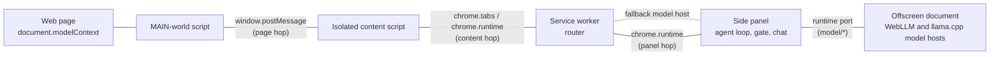
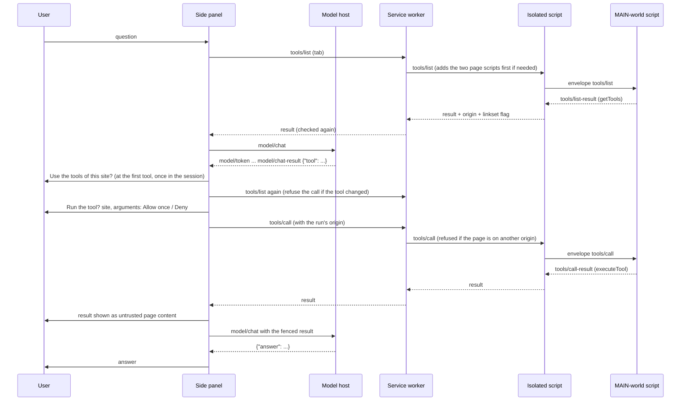

# Architecture

WebAIAssist is hexagonal: a core with the agent loop and its rules, ports (TypeScript interfaces)
around it, and adapters that implement the ports with browser APIs or libraries.

## What it does, in four statements

1. **Four model paths**, one `ModelRuntime` port: WebLLM on the graphics card, llama.cpp in
   WebAssembly on the processor, Chrome's built-in model (Prompt API), and an OpenAI-compatible
   endpoint. The panel picks a default by what the computer has and one measurement, and says why;
   a model the user chose is kept ("Where the model runs", below).
2. **A page card that follows the tab**: the site, an access badge, the page's WebMCP tools (what
   each does; reads or changes), and what the site publishes (llms.txt, knowledge link set, API
   catalog, agent card, security.txt, AI policy, JSON-LD). It is redrawn when the tab, the
   address, the title or the tools change ("Following the page and reading the site").
3. **A site's "no AI input" signal is respected**: `Content-Signal: ai-input=no` in `robots.txt`
   holds back the site's text and files and "Read this page". Results of the site's own tools are
   not held back, and the panel says so. A click on **Use on this tab anyway** overrides it for
   the local model on that tab only ([THREAT-MODEL.md](THREAT-MODEL.md), "Site files").
4. **The only way it acts is a tool the page registers itself.** Each call goes through the
   confirmation gate; the extension's code does not navigate, click, fill in forms, download or call
   another site ("The confirmation gate", "Trust boundary").

## Core and ports

`src/core/` holds the agent loop, the confirmation gate, the reply parser, the prompt builder, the
untrusted-data fence, node-mode detection, the per-site consent rule and the Markdown export. It
imports nothing from `src/adapters/`, `src/entries/`, `src/spike/`, `src/fakes/`, `src/ui/` or
`src/protocol/`, and it uses no browser API. Two checks enforce this: `tsconfig.core.json`
compiles the core without the DOM types, and an ESLint rule (`eslint.core-boundary.js`) refuses
those imports and the browser globals. Both run in `npm run verify`.

| Port            | What it does                                                            | Adapters                                                                                                                                 | Fake                                       |
| --------------- | ----------------------------------------------------------------------- | ---------------------------------------------------------------------------------------------------------------------------------------- | ------------------------------------------ |
| `ModelRuntime`  | Loads a model, streams a reply, stops on request                        | `webllm-runtime.ts`, `prompt-api-runtime.ts`, `endpoint-runtime.ts`, `port-model-runtime.ts` (the panel's link to the model host)        | `FakeModelRuntime`, `ScriptedModelRuntime` |
| `ToolBridge`    | Lists (with the page's origin) and calls the tools of the page in a tab | `messaging-tool-bridge.ts` (panel), `tool-router.ts` (service worker), `page-bridge-isolated.ts` and `page-bridge-main.ts` (in the page) | `FakeToolBridge`                           |
| `Memory`        | Chat per site, tool success counts per site, clear                      | `indexeddb-memory.ts`; `no-memory.ts` when memory is off in Options                                                                      | `InMemoryMemory`                           |
| `ChatUI`        | Shows events and the streamed draft, asks Allow or Deny                 | `src/ui/panel-ui.ts`                                                                                                                     | `FakeChatUI`                               |
| `SiteGrants`    | Sites whose tools the user allowed in this session                      | `session-site-grants.ts` (`chrome.storage.session`)                                                                                      | in the tests                               |
| `Clock`         | The time, so tests use a fixed past date                                | `Date` in `src/entries/sidepanel.ts`                                                                                                     | `FixedClock`                               |
| `ArgsValidator` | Checks tool arguments against the tool's `inputSchema`                  | `cfworker-args-validator.ts` in the extension; `ajv-args-validator.ts` in Node and tests                                                 | (Ajv in tests)                             |

Tool schemas arrive from the page at runtime, and Manifest V3 extension pages forbid
`new Function`, so Ajv cannot compile them in the extension. The extension uses
`@cfworker/json-schema`, which interprets the schema instead of generating code (JSON Schema
2020-12). One shared test runs the same cases against both validators. Both refuse a schema whose
`pattern` could backtrack for a long time (over 200 characters; a repeated group that contains a
quantifier or alternatives at any depth, found by tracking paren depth; three quantified atoms in
a row; back-references) before any pattern runs, and both report errors as path and keyword only, so no
schema text reaches the model in a repair turn (`src/adapters/args-checks.ts`). The message schemas, which
are known at build time, stay compiled ahead of time by Ajv (`npm run gen:validators`).

## The agent loop

Each run starts from a user message. The loop (`src/core/agent-loop.ts`):

1. Binds the run to the tab and the site (origin) it starts on. Lists the page's tools and the
   site's tool counts, and builds the messages. On an AgenticSystemCore node it adds a short hint
   on the roles of the ten node tools. Page text from "Read this page" goes in before the
   question, fenced as untrusted data, but only when it was read on the same tab and site. The
   site's saved chat is trimmed before every request to fit the model's context window (4096
   tokens for the browser models, the Options value for an endpoint, the window Chrome reports
   for its built-in model), oldest turns first, with room for the reply (the runtime may ask for
   more than the default 512 tokens) and for one more tool result as large as the largest of the
   run. A runtime with a small window (`compactPrompt` in its capabilities, Chrome's built-in
   model) gets the compact prompt of `src/core/compact-prompt.ts`: short rules and one line per
   tool, `name(arg*:type): purpose`, at most 12 lines and 22 % of the window, the other tools by
   name only. The full input schema stays in the core and still validates every call. Tokens
   are estimated: three Latin characters per token, one per CJK or other non-Latin character
   (`src/core/history.ts`). On a page with tools both prompts add the tool rules of
   `src/core/tool-rules.ts` (the model cannot see the site, so it calls a tool first; site files
   are background; read-only tools first, others only when the user asked; answer from the first
   sufficient result); read-only tools are listed first. The site text for a question is cut to
   the limit of `siteContextLimit` (12,000 characters; 2,400 for a window of 4096 tokens or
   less; 1,500 for the compact prompt).
2. Asks the model for one JSON action: `{"tool": ..., "arguments": {...}}` or `{"answer": ...}`.
   While the reply streams, the panel shows the answer text so far; a tool call shows nothing.
3. Checks the action (`src/core/check-action.ts`): valid JSON, a listed tool, arguments that
   match the tool's schema. A bad action gets one repair try; a second bad action in a row stops
   the run with a visible error. When the arguments missed the schema, the repair message quotes
   the tool's fields and their types in one line (`src/core/tool-signature.ts`, for example
   `"propose" takes: slug (string, required), agent (string)`), and the final message names the
   tool: "The model could not fill in the arguments for propose. It takes: …". Only plain field
   names and JSON type words are quoted; enum values and descriptions of the page are not.
   A call identical to one already made in the question (same tool, same arguments, key order
   ignored; `src/core/repeat.ts`) is not run and not asked about again. The first time, the model
   gets the earlier result again with one line to answer now; the next time, the question ends
   with an answer built from the results in hand. Both times the panel shows one plain note. The
   assistant turn that is saved holds no page text.
4. Lists the tools again and refuses the call if the tool's description, schema or annotations
   changed since the model saw them. If any listing names another site than the run's (the tab
   navigated), the run ends with a visible error and nothing more is run.
5. Applies the confirmation gate (below), then lists the tools once more, because the page may
   change the tool while the user decides.
6. Calls the tool, with the run's origin in the request: the isolated script refuses the call if
   the page is on another site. Records success or failure for the site, shows the result in the
   transcript as untrusted page content, and gives it to the model inside a
   `<tool-result trust="untrusted">` fence, cut at 4000 characters and cleaned
   (`src/core/sanitize.ts`): invisible characters (bidi, zero-width, tag characters, variation
   selectors) removed and every turn-marker shape broken (`<|`, `|>`, `</`, `<s>`, `<<SYS>>`,
   `<start_of_turn>`, `[INST]`, full-width look-alikes included); every other character stays,
   so a value the model copies back still matches the page's schema. Tool names and schemas go
   to the model as the page wrote them; a tool whose name, schema strings or description hold a
   marker, or whose name or schema hold a hidden character, is not offered to the model.
7. Stops on an answer, after the step cap (6 by default, 1 to 12 in Options; the message says
   "The assistant stopped after 6 tool steps (the limit in Options)."), or on Stop.

## The confirmation gate

When a tool of a site is first about to be used in a browser session (not before: a question the
model answers without a tool asks nothing), the panel asks "Use the tools of this site?" and
names the number of tools. The loop asks it through `AgentDeps.siteGate` (`src/core/site-consent.ts`),
before the question about that call. Allow is kept in `chrome.storage.session`, which the
browser clears when it restarts; Deny means no tool runs for the rest of that question and the
model is told so.

Then each tool call goes through the gate, in one of the two modes set in Options:

| Mode                      | Read-only tool (`readOnlyHint`, not `consequentialHint`) | Any other tool, or no annotations |
| ------------------------- | -------------------------------------------------------- | --------------------------------- |
| Ask every call (default)  | asks                                                     | asks                              |
| Once per site per session | runs                                                     | asks                              |

The question shows the tool name, the site and the arguments, and offers Allow once or Deny.
There is no "always". Deny has the focus first, Escape means Deny, and Stop answers Deny. A tool
the user denied is refused without a second question for the rest of that question's run.

## Parts of the extension and message flow



One question that calls one tool:



Every message is checked against its JSON schema when it arrives (`src/protocol/validate.ts`),
and each hop accepts only its own message types:

| Hop       | Between                                                   | Message types                      |
| --------- | --------------------------------------------------------- | ---------------------------------- |
| page      | MAIN-world script, isolated script                        | `tools/*`, inside a `PageEnvelope` |
| content   | isolated script, service worker                           | `tools/*`                          |
| panel     | side panel or spike page, service worker or model host    | `tools/*`, `model/*`, `probe/*`    |
| offscreen | service worker or panel to the offscreen document or host | `model/*`, `probe/*`               |

The service worker and the model hosts accept messages and ports only from the extension's own
pages (`src/entries/shared/sender.ts`), never from a content script.

The isolated script sends at most one `tools/changed` notice per 250 ms, however often the page
fires `toolchange`. The MAIN-world script lists and runs only entries of the page's own origin
whose name no other entry uses.

## Where the model runs

The chat request of the `ModelRuntime` port has an optional `onUsage` callback. Only the endpoint
runtime calls it, once per chat, with the prompt and completion token counts and the price (US
dollars) the service returned in the last chunk of the stream. Nothing in this release stores or shows them
(`src/core/ports/model-runtime.ts`); the endpoint evaluation script prints them.

WebLLM needs WebGPU. The panel probes for it when the user presses Start and uses the first host
that has an adapter: the offscreen document, then the extension service worker
(`src/adapters/host-choice.ts`). The order was chosen from a measured run on 12 Nov 2026 (Windows
10, Chrome 157, AMD gcn-5): WebGPU with `shader-f16` and 2 GiB buffers was available in the page,
the service worker and the offscreen document alike ([SPIKE.md](SPIKE.md)). The offscreen document
is the host because it has no idle time limit; the service worker is the proven fallback. In
the offscreen document WebLLM runs in a dedicated module Worker (`model-worker.js`, through
WebLLM's `WebWorkerMLCEngine`), which is the reason the document is opened for (`WORKERS`); the
service worker cannot start a Worker, so there WebLLM runs in place. The model stays loaded in
the host when the panel closes. While a model loads, the panel shows Cancel: it sends
`model/cancel`, and the host unloads the engine, which stops WebLLM's download.

The model the panel selects is the one the user chose, which is kept in the Options
(`runtime` other than `auto`); until then the panel picks a default and says why in one sentence
under the list (`#model-why`; `src/ui/default-model.ts`). The order is: Chrome's built-in model
when Chrome says it is available (not while it still has to download); the graphics card when a
stored measurement says its first answer was not slow; the processor model; the graphics card,
unmeasured, where the processor model cannot run (Chrome before 137); a configured endpoint;
Chrome's built-in model still to download; the choice **Set up a chat endpoint**, for which Start
opens Options and loads nothing. The measurement is the wait from the first question after a
load to the first token (`src/ui/first-token-timer.ts`), stored with the adapter's name in
`chrome.storage.local` (`src/adapters/stored-panel-state.ts`); more than 20 seconds is slow
(`src/adapters/gpu-speed.ts`: the maintainer's laptop took about 40 s on 13 Nov 2026, the first
answer compiles the GPU programs). So the graphics card becomes the default only after the user
has tried it once and it was quick; a measurement made on another adapter is ignored. Settings
saved before 13 Nov 2026 (version 1) that name Chrome's built-in model go back to the default
once, and the stored default of version 2 (`webllm` with no model named) reads as automatic
(`src/adapters/settings.ts`).

**Asking before a download.** Pressing Start on a model whose weights are not stored shows a
question first (`#consent`, `src/ui/panel-consent.ts`): the size, the host the weights come from,
that they are stored in this browser, and **Download** or **Not now**. Nothing downloads before
Download; offline, the block says the model is not on this computer and offers nothing. Chrome's
built-in model asks the same way when Chrome says it must download, and that click is the user
activation Chrome needs. Whether a model is stored comes from one store over both runtimes
(`src/adapters/model-store.ts`; WebLLM's Cache Storage through WebLLM's own `hasModelInCache`,
`deleteModelAllInfoInCache`, and wllama's file storage). The Options page lists the stored models
with their sizes and removes one or all (`src/ui/options-storage.ts`); both pages are on the
extension's own origin, so they see what the offscreen document wrote. When no host finds an
adapter, the error and **Use the processor instead** appear before any question
(`src/ui/panel-model.ts`, `src/ui/panel-problems.ts`).

WebLLM gets a model list with these four models only (`src/adapters/webllm-app-config.ts`). The
model library of each (`.wasm`, compiled code) is a file inside the package: the build copies
it from `vendor/model-libs/`, where it was fetched once from a pinned commit of
`mlc-ai/binary-mlc-llm-libs` and checked against its SHA-256 (`scripts/model-libs.json`,
`scripts/model-libs.mjs`). WebLLM checks the same hash again before it runs the library. The
build also replaces WebLLM's own remote library address, and the build check refuses any bundle
that names `raw.githubusercontent.com` or a remote `.wasm` file
(`scripts/check-remote-code.mjs`): the Chrome Web Store does not allow code from outside the
package. The weights are data; they download from one fixed revision of each model's Hugging
Face repository, and WebLLM checks the model's `mlc-chat-config.json` and `tokenizer.json` against
SHA-256 values pinned per revision. Other models run through a chat endpoint.

The weights download once (about 350 MB for Qwen3 0.6B, 1.8 GB for Llama 3.2 3B, 1.1 GB for
Qwen3.5 2B, 2.8 GB for Gemma 4 E2B) into WebLLM's
Cache Storage. The extension does not ask for `unlimitedStorage`: the smoke test measured a
storage quota of 10 GiB for the extension in Chromium on 12 Nov 2026, enough for the first two models; the four together are about 6 GB, which fits the same quota.
On a nearly full disk the quota is smaller and the download can fail; the error is shown.

### The processor model (llama.cpp in WebAssembly)

For a computer without a usable graphics card, or with little graphics memory, the panel offers
Qwen3 0.6B, Qwen3 1.7B and Qwen3.5 2B on the processor (`src/adapters/wllama-runtime.ts`, package
`@wllama/wllama` 3.8.1). The choice is listed only when the browser has WebAssembly promise
integration and 64-bit memory (Chrome 137; `src/adapters/cpu-support.ts`); the manifest minimum
is 126, because compat mode's polyfill uses `URL.parse`.

- **Where.** In the offscreen document, behind its own port `model-host:cpu` (the service worker
  cannot start a Worker, so it does not host this runtime). The panel reaches it with the same
  `PortModelRuntime` and the same `model/*` messages as WebLLM; the panel gives it the
  capabilities (`src/adapters/cpu-models.ts`): replies constrained by a JSON schema, a 4096-token
  window. wllama starts its own Worker from a `blob:` URL built from code inside the package;
  the extension's content security policy allows that and is unchanged.
- **One model in memory.** `ExclusiveRuntime` lets the WebLLM runtime go before the processor
  model loads, and the other way round.
- **Files.** The engine `model-libs/wllama.wasm` is copied in by the build and checked by hash
  (`scripts/model-libs.json`, `runtimes`). The weights are data: a fixed Hugging Face address per
  model, with the recorded size and SHA-256.
- **Weights.** wllama stores them in the extension's private file storage. After a download the
  runtime compares size and SHA-256 with the record; a file that differs is deleted and never
  loaded. A stored copy that was checked once is marked in wllama's cache record and starts
  with no network request and no new hash. Cancel aborts the download request at once and
  deletes what was written; a dropped connection deletes the partial file.
- **Threads.** wllama uses half the cores when the page can share memory between threads. An
  extension page can (measured 14 Nov 2026: 8 threads, `crossOriginIsolated` false), so the
  manifest has no isolation keys. If it could not, the model would run on one thread.
- **Reply.** Qwen's settings for replies without reasoning text (temperature 0.7, top-p 0.8,
  top-k 20, `enable_thinking` off); the action schema goes in as `response_format` (llama.cpp
  turns it into a grammar); the core still checks the action and the arguments.
- **Tests.** The runtime is tested with a fake engine for every path
  (`test/adapters/wllama-runtime*.test.ts`). The smoke build uses a fake engine with four test
  models (`src/fakes/fake-wllama-engine.ts`); the release build holds none of it
  (`scripts/check-dist.mjs`). `npm run eval:cpu` runs the real engine and model.

Chrome's built-in model (Prompt API) and an OpenAI-compatible endpoint run from the side panel
itself. Tool calls use prompted JSON for every runtime: native tool calls exist in WebLLM only for
models that are not shipped, and Chrome gives no reliable way to detect tool support in the
Prompt API (an unknown `tools` option is ignored, not refused).

Chrome's built-in model in detail (`src/adapters/prompt-api-*.ts`):

- `load()` calls `create()` first, straight from the Start click (Chrome starts a download only
  with the click's user activation), with a `monitor` for progress and the Cancel signal. The
  panel starts the new built-in runtime before it lets the old model go, so a slow unload cannot
  use up the activation. A poll shows Chrome's availability state with a plain reason; it never
  ends the load: only `create()` rejecting does.
- The window is read from the first session (`contextWindow`, older Chrome `inputQuota`; 4096
  when Chrome gives none) and reported through `capabilities()`. The reply room is a quarter of
  the window, at most 1024 tokens.
- The reply is constrained: `promptStreaming(..., { responseConstraint, omitResponseConstraintInput:
true })` with the action schema, whose `tool` is limited to the tools listed for the page
  (`actionSchema` in `src/core/action.ts`). If Chrome rejects the schema before the first piece,
  the question is asked once more without it. The core's check of a call's arguments stays.
- When Chrome says the input is too long (`QuotaExceededError` with `requested` and
  `contextWindow`, or its own measure before the question when this Chrome has one), the oldest
  earlier turns are cut once in that proportion and the question is asked again; if it still
  does not fit, the panel names the sizes.
- `create()` never gets `topK` or `temperature` (both or neither, and `params()` is null in
  Chrome 157). `unload()` and the panel's `pagehide` destroy any session that is still answering.

## Following the page and reading the site

The panel keeps the card on the tab in front. `src/ui/panel-follow.ts` gathers the browser events
(tab switch, window focus, page loaded, address changed, title changed, tools changed, access
granted) and gives one refresh a quarter of a second after the last event; a title change alone
redraws the title only. `src/ui/panel-page.ts` takes a number for each refresh and drops an
answer that comes back after a newer refresh began. A refresh lists the page's tools; only for
a site it could list, it reads the tab's title and address, the page's own data (JSON-LD, Open
Graph, meta) and the site's files, then draws the card (`src/ui/page-card.ts`).

```text
core (pure)                                  adapters                         ui
site-files.ts   fixed list, limits, checks   site-page-scripts.ts  (runs in    panel-page.ts   refresh
site-llms.ts  site-linkset.ts                  the tab, isolated world)          panel-follow.ts events
site-small.ts site-robots.ts site-page.ts    site-files.ts  (pool, limits,    panel-switch.ts site change
site-facts.ts   chips, node, AI policy         schema check of each answer)     page-card.ts    drawing
site-context.ts text for the model           protocol/site-schemas.ts           site-fact-lines.ts
tool-card.ts    name, line, reads/changes
```

When the site changes, `panel-switch.ts` stops a running answer with one plain line, denies a
question waiting in the dialog, and shows the chat of the new site (saved with Memory on, empty
with Memory off). The "site facts" go to the model as one fenced block before the question
(`AgentInput.siteContext`), are marked transient in the loop, and are left out of the saved chat.
The message hop `site` carries `site/file`, `site/page` and `site/graph-file` from the injected script to the panel
(`src/protocol/messages.ts`).

## The graph explorer tab

The card's "Graph: N items" button (built in code, `src/ui/page-card.ts`; N is the sum of the node's
`agsc-counts`, `src/core/graph-files.ts`) makes the panel open `explorer.html?tabid=...&origin=...&src=...`
in a new tab (`src/ui/explorer-url.ts`, `chrome.tabs.create`, no permission). The page is one extension page
with a tab list (`src/ui/explorer/tabs.ts`, `shell.ts`); this release has the Graph, Query, Vocabulary and
Page data tabs (see "Query and semantic tools" below).

```text
core (pure)                              adapters                           ui / entry
graph-files.ts  list, caps, counts       graph-files.ts  one file through   explorer.html (site markup, pinned)
site-linkset.ts counts, graph address      the tab, schema check            entries/explorer.ts  boot
                                         graph-fetch-guard.ts  decide(url)  ui/explorer/graph-tab.ts, peers-block.ts
                                         peers.ts  peer origin rules        ui/explorer/shell.ts, link-opener.ts
                                         linkset-digests.ts  declared       ui/explorer-url.ts  page address
                                           SHA-256 per file                 third_party/agsc-explorer/*  (unchanged)
                                         explorer-tab-reader.ts  "left      explorer-vendor/ (build output)
                                           the site" rule
                                         graph-fetch-shim.ts  window.fetch
                                           for the site's code: tab, peer,
                                           digest, caps
```

The explorer's own code (the site's, copied unchanged and pinned by hash, `third_party/agsc-explorer/PINS.json`)
calls `window.fetch`; the page installs `createGuardedFetch` first. Own files come through the tab (the same isolated-world
script as the site files, with the `site/graph-file` message); a ticked peer is read with one plain request; everything else is
refused. force-graph 1.52.0 is copied from `node_modules` by the build after its hash is checked
(`scripts/explorer-pins.mjs`), in the folder layout of the site (`explorer-vendor/assets/...`). Threats and controls:
[THREAT-MODEL.md](THREAT-MODEL.md), "Graph explorer tab".

## Query and semantic tools

One query worker serves the Query tab and the model's tool. The worker (`src/entries/query-worker.ts`, built as
`query-worker.js`, a module Worker of the extension) holds Oxigraph and one store; a page posts the bytes of the node's
`graph.nq` and then one query at a time; the worker has no address to ask. A page ends the worker to stop a query
(the engine is synchronous).

```text
core (pure)                       adapters                              query/ (no browser API but Worker)   ui / entry
ports/graph-query.ts GraphQuery   graph-load.ts  graph.nq or vocabulary   protocol.ts  messages, limits         ui/explorer/query-tab.ts
builtin-tools.ts  QUERY_TOOL,       through the tab, digest checked       worker-core.ts  load, run, row cut      ui/explorer/vocab-tab.ts
  isReservedName, mergeTools,     query-session.ts  one worker per node,  format.ts  rows as text, prefixes       ui/explorer/page-data-tab.ts
  GRAPH_HINT, failureText           stop, time limit, one query at once   examples.ts  the ten questions           ui/explorer/result-table.ts
                                  graph-query.ts  the port: run, summary   third_party/agsc-query/*  (unchanged)   entries/query-worker.ts
```

Read-only is the engine's own rule (`third_party/agsc-query/engine.js` `queryAnswer`, which calls the tokenizer
`tokens.js` first); `src/query/worker-core.ts` only adds the limits (4,000 characters of query, 200,000 statements, the
row cut). The tab's table is the site's `queryTable` tree turned into DOM with text nodes only
(`src/ui/explorer/result-table.ts`). The vocabulary file is loaded as Turtle into a second store, only when the
Vocabulary tab is first shown, and never merged with the graph.

The model's tool is built from the same parts. `GraphQuery` (core port) has `available`, `summary` and `run`;
`src/adapters/graph-query.ts` implements it. The tool is not a page tool and cannot be taken by one:
`mergeTools` removes every page tool whose name is, or reads like, a name of WebAIAssist (`isReservedName`: compatibility
forms folded, case dropped, look-alike letters mapped, everything but ASCII letters and digits removed, then "starts with
webaiassist") before the list is built, so a call by name can only meet the built-in one; the prompt lists it in its own
section; the card marks the removed tools. Its results are node-author text and are fenced as untrusted like any tool result.
Threats and controls: [THREAT-MODEL.md](THREAT-MODEL.md), "Query and semantic tools".

## Activity log

A port `ActivityLog` (`src/core/ports/activity-log.ts`) with an IndexedDB adapter (`src/adapters/indexeddb-activity.ts`,
database `webaiassist-activity`, stores `questions` and `settings`). The side panel watches a question without a change
in the agent loop: `traceModel` wraps the `ModelRuntime` (first word, usage, price, window use) and `traceUi` wraps
the `ChatUI` (the confirmation and the loop's tool events) in `src/core/activity-wrap.ts`; a `QuestionTrace`
(`activity-trace.ts`) builds one record, and `src/ui/panel-activity.ts` writes it when the question ends, also after a
failure or Stop. The built-in query tool needs no hook of its own: `runBuiltin` already shows its call and result, so the
wrapper records it as a built-in call (`test/core/activity-builtin-loop.test.ts`).

The Activity tab (`src/ui/explorer/activity-tab.ts`, with `activity-view.ts`, `activity-ask.ts` and
`activity-rerun-ui.ts`) is one more entry of the tab registry. `explorer.html?view=activity` starts the page with this
tab only, so it works when no node is open; the panel's **Activity log** button (More area) opens that address. Totals,
filters, export and re-run are pure code in `src/core/activity-summary.ts`, `activity-export.ts` (schema in
`activity-schema.ts`) and `activity-rerun.ts`. Threats and controls: [THREAT-MODEL.md](THREAT-MODEL.md), "Activity log".

## Look and feel

All colours, sizes and type are design tokens at the top of `static/ui.css` (light in `:root`,
dark in one `prefers-color-scheme` block). Components use the tokens only, so a theme change is
one block. The card's heading and badge come from the page status (`accessBadge` and `siteName`
in `src/ui/page-status.ts`); the tools list rows are drawn in `src/ui/page-card.ts` from the
rows of `src/core/tool-card.ts`; transcript lines get their class (`user`, `assistant`, `tool`,
`note`) in `src/ui/transcript-view.ts`. Colours are checked by `test/ui/contrast.test.ts`, which
parses the tokens from the stylesheet. Nothing is loaded from outside the package: no font, image
or library; icons are not used.

## Permissions and access to sites

Install permissions: `sidePanel`, `offscreen`, `storage`, `activeTab`, `scripting`. There are no
install-time host permissions and no declared content scripts.

The page scripts are added with `chrome.scripting.executeScript` under `activeTab`: the user's
click on the toolbar button gives access to the open tab until it navigates to another site.
Chrome grants `activeTab` for that click only when the click does not open the side panel by
itself (`ExtensionActionRunner::RunAction` in Chromium skips the grant when
`openPanelOnActionClick` is true). So the service worker sets `openPanelOnActionClick: false`
and handles `chrome.action.onClicked` (`src/adapters/action-click.ts`): it opens the panel with
`chrome.sidePanel.open()` inside the click, adds the page scripts, and sends `tools/changed`
so an open panel reads the page again. Both callers of the injection (the click and the panel's
first request) share one injection per tab, and the MAIN-world script goes in before the
isolated relay, so a relay that answers always has a script to relay to
(`src/adapters/tab-injection.ts`).

The side panel can also be opened from Chrome's side panel menu, which grants nothing. The
panel then reads the open page at start, on a tab switch, on a navigation, on `tools/changed`
and after a site grant. When the service worker cannot add the page scripts it says why in the
listing (`access`: `denied`, or `restricted` for `chrome://` pages, the Web Store and error
pages; `src/adapters/page-access.ts`). The status line at the top of the panel shows the site
and its tools, "no WebMCP tools", "not allowed yet" with an **Allow** button, or "cannot run
here" (`src/ui/page-status.ts`). A page without `document.modelContext` lists no tools; that
is a state, not an error. Messages about the last action share one line (`#page-note`), each
replacing the one before, and the conversation never shows the same error twice in a row.

**Allow** (`src/adapters/site-access.ts`) asks for one site. Without `tabs` or a host
permission Chrome hides the tab's address from the extension, so the panel usually does not
know the site yet. Then Allow calls `chrome.permissions.addHostAccessRequest({ tabId })`
(Chrome 133 and later): Chrome shows the request in its toolbar, naming the site, and accepting
it grants that site's origin; `chrome.permissions.onAdded` makes the panel read the page again.
When the panel does know the site, Allow calls `chrome.permissions.request` for that one
origin from the click. On an older Chrome the panel points to the toolbar button.

The manifest lists `optional_host_permissions` (`https://*/*`, `http://localhost/*`,
`http://127.0.0.1/*`); nothing is granted at install, and each grant is one site, asked from the
user's click. A remote chat endpoint such as `openrouter.ai` uses the `https://*/*` entry: Options
asks for that one host from the Save click, and the panel asks the user once per host before the
first chat is sent (`src/ui/panel-consent.ts`; the agreed hosts are in the panel's stored state).
Besides Allow, two features need such a grant:

- Compat mode registers the WebMCP polyfill to run at document start on reload, so the page's own
  scripts find `document.modelContext` when they register their tools. A registered content
  script needs host access to the site; `activeTab` does not cover it. The registration is
  dropped when the browser restarts.
- An endpoint in Options is fetched from the side panel; an extension page needs host access to
  read a cross-origin reply. The grant is asked when the user saves the endpoint. Redirects are
  refused, a reply is capped at 1 MB, and the connection check gives up after 15 seconds.

**Forget this site** gives a site's access back (an Allow grant included) (`chrome.permissions.remove`), unregisters its
compat script, and clears its memory and session allowance (`src/adapters/forget-site.ts`).

Plain `http` is accepted only for `localhost` and `127.0.0.1`; an address with a user name or
password is refused. The service worker restricts `chrome.storage.local` (Options, API key) to
the extension's own pages. The development build (`dist-smoke/`, `npm run build:smoke`) adds
`http://127.0.0.1/*` as an install-time host permission for its local test page, the `?tab=`
override and the browser check (spike) page; the release build checks that `host_permissions` is
empty and that none of the development parts are present (`scripts/check-dist.mjs`,
`scripts/check-zip.mjs`).

Extension pages run under `script-src 'self' 'wasm-unsafe-eval'; object-src 'self';`: the Manifest
V3 minimum plus WebAssembly, which WebLLM needs. The build check refuses any other policy, refuses
`web_accessible_resources` and `externally_connectable` (no web page or other extension can open
or message the extension's pages), and scans every bundle for `eval`, `new Function`, remote
scripts and remote code.

## Trust boundary

The MAIN-world script runs inside the page's own JavaScript world. That is the only way to reach
`document.modelContext`, and it means the page can see that script, call it, and send messages
that look like its messages. Everything that crosses from the MAIN-world script into the extension
is therefore untrusted:

- The isolated script accepts only messages of its own window (not of frames inside the page),
  in a `PageEnvelope` on its random per-injection channel, with the id of a request it sent,
  and checks each one against its schema. The page's origin and
  the linkset flag come from the isolated script's own world, not from the page.
- Tool names, descriptions, schemas and results are data. The system prompt says so, results are
  fenced and shown as untrusted, and nothing from the page changes the tool list, the gate or the
  system prompt rules.
- The gate is decided in the core from the annotations the page declared and the mode in Options;
  a page cannot skip it.
- The extension calls tools of the top frame's own origin only.

## Folders

```text
src/core/       agent loop, gate, parser, prompt, fence, node mode, consent, export, ports
src/adapters/   model runtimes, page bridge, router, memory, settings, grants, validators, probes
src/protocol/   message types, JSON schemas, generated validators, parseMessage
src/ui/         side panel and Options page logic, strings (messages-en.ts; the build writes them to _locales/en/messages.json, scripts/locale.mjs), the explorer tab (src/ui/explorer/)
src/fakes/      in-memory fakes of the ports, the scripted test model
src/spike/      browser check logic (report, stub node tools, WebMCP check)
src/entries/    service worker, offscreen, side panel, Options, page scripts, polyfill, spike page
static/         manifest template, extension HTML pages (including explorer.html), ui.css, explorer.css, icons (SVG source and PNGs)
third_party/    unchanged copies of other repositories' files with their pins (agsc-explorer: the site's graph explorer; agsc-query: its query engine files)
src/query/      the query worker's core, messages, result text and example questions (no page API)
spike/          spike page HTML
fixtures/       the ten tools of an AgenticSystemCore node page
scripts/        build, dist and zip checks, model-library pins, validator generator, spike server
vendor/         model libraries fetched once by the build (not in git)
test/           unit tests (Vitest), fixture replay, adversarial tests (test/security),
                browser smoke and accessibility tests (Playwright, test/smoke)
```

## Package P2 additions (14 Nov 2026)

- Digest check: `src/adapters/site-page-scripts.ts` adds the base64 SHA-256 of a whole body to
  `site/file`; `src/core/site-digest.ts` compares it with the digest in the node's link set;
  `src/core/site-facts.ts` drops a mismatching file from the facts (so from the model's context).
- New readers: `src/core/site-sustainability.ts`, `parseRobotsGroups` in `src/core/site-robots.ts`,
  `pageLinkRows` and the creator and distribution fields in `src/core/site-page.ts`.
- Texts and lines of these: `src/ui/messages-p2-en.ts`, `src/ui/site-fact-lines-p2.ts`; starter
  questions: `src/ui/starter-prompts.ts`.
- `tools/list-result` carries `webmcp` (the page has a WebMCP interface); `src/ui/page-status.ts`
  words the reason for "no tools" from it.
- Diagnostics: `src/core/diagnostics.ts` (text), `src/ui/diagnostics-ui.ts` (preview and copy),
  `src/ui/panel-diagnostics.ts` (panel facts), `src/entries/options.ts` (Options facts).

## Conformance page and its runs

`conformance/` is a static page, outside the extension, that exercises the WebMCP interface; its
`expect.json` drives the browser tests (`test/smoke/conformance-browser.spec.ts`,
`test/smoke/conformance.spec.ts`) and the real-Chrome runs (`scripts/eval/conformance.ts`, with
`conformance-run.ts` for the panel steps, `demos.ts` for Google's demo pages and `chrome-launch.ts`
for starting Google Chrome). Nothing in `src/` depends on it.

## Package P7d additions (14 Nov 2026)

- Node card and help screens: `src/ui/node-card.ts` (drawing, the demo address constant, the start
  command, the switch address), `src/ui/panel-node-card.ts` (panel hook called from `drawPage`,
  and the "Copy report" button), texts in `src/ui/messages-node-card-en.ts`.
- Developer report: `src/core/tool-report.ts` (Markdown text, schema and annotation checks);
  `src/core/review-flags.ts` is the hook for the "Security review flags" rows: replace the body of
  `reviewFlags` (same signature) and the report needs no change.

## Package P7b additions (14 Nov 2026)

- Review: `src/core/tool-review.ts` (nine rules, `DefinitionLedger`, `reviewTools`), `src/core/tool-review-text.ts`
  (one plain sentence for each finding, used by the panel and the report), `src/core/tool-offer.ts` (which tools
  the model is offered and which the user sees), `mustAsk` in `src/core/gate.ts`. `reviewFlags` in
  `src/core/review-flags.ts` now returns the findings for the developer report.
- Panel: `src/ui/tool-item.ts` (a list row), `src/ui/tool-detail.ts` (detail view and the "Run…" box),
  `src/ui/panel-manual-run.ts` (a run started by hand: core `runTool` with `manual` and "ask for every call",
  no model), `src/ui/confirm-parts.ts` (reasons and form lines in the question), `src/ui/messages-parity-en.ts`.
  The second question lives in `PanelUI.confirmToolCall`.
- Wire: `tools/cancel` (panel, service worker, isolated relay, MAIN script) so Stop reaches the page's tool;
  the `debugging` hint and the declarative form facts travel with a tool.
- Toolbar number: `src/adapters/tool-badge.ts` (pure, injected browser calls) and `src/entries/shared/badge-wiring.ts`
  (events); it asks `permissions.contains` for the tab's origin and lists tools only when the site is allowed.
